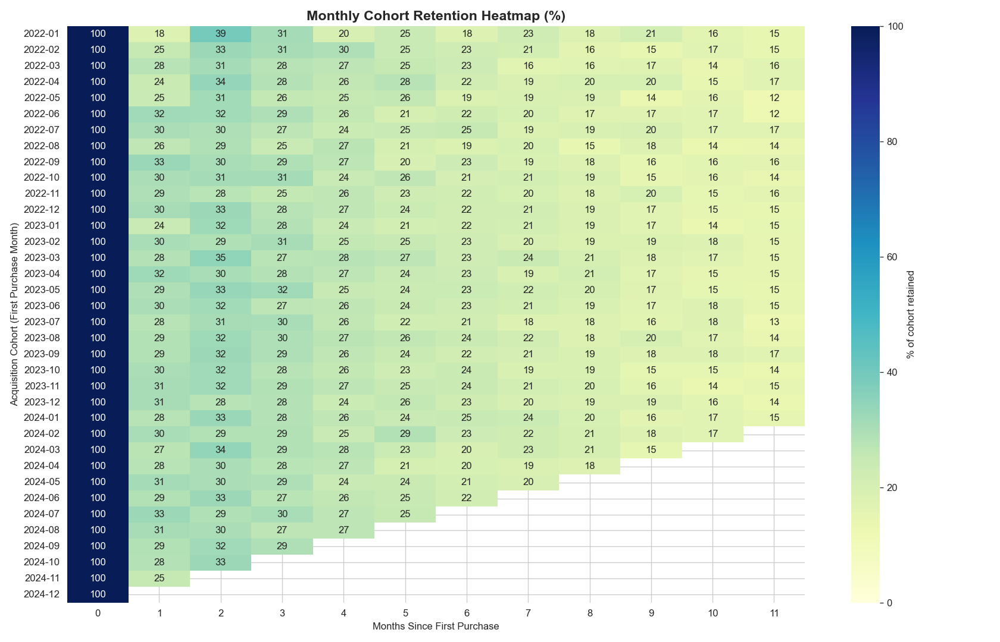
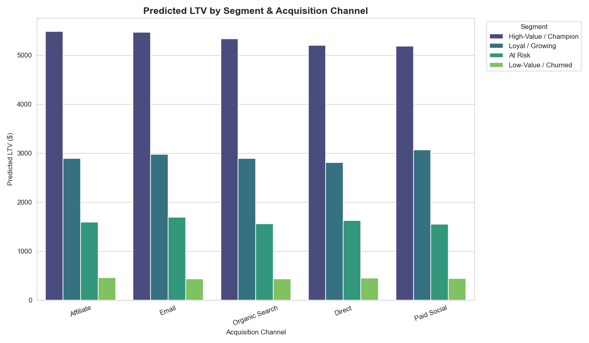
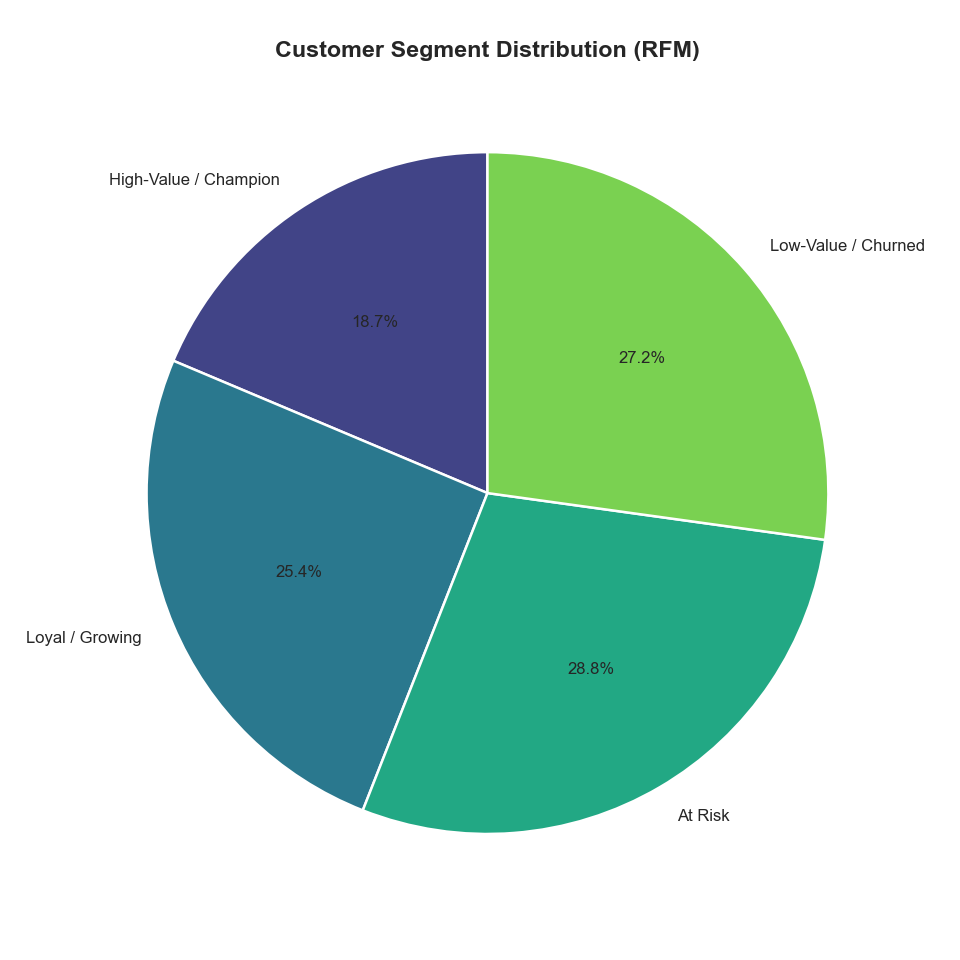
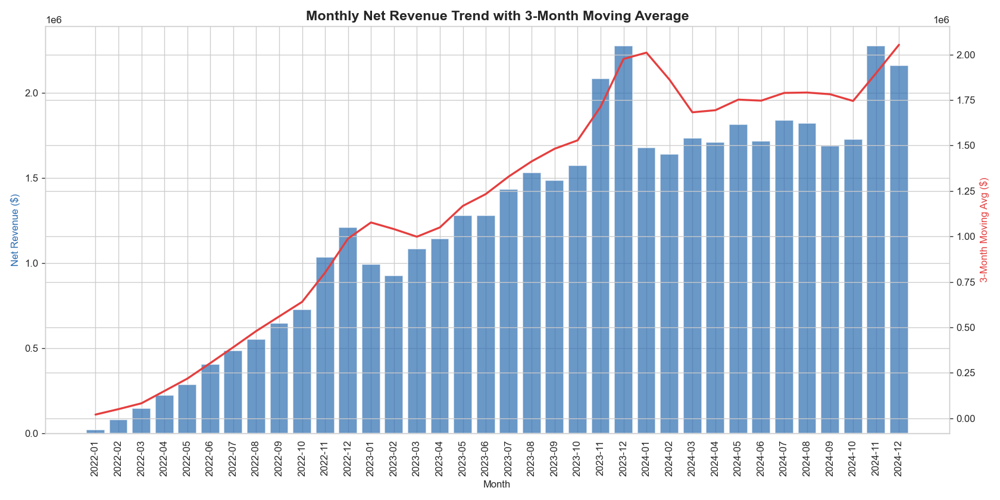
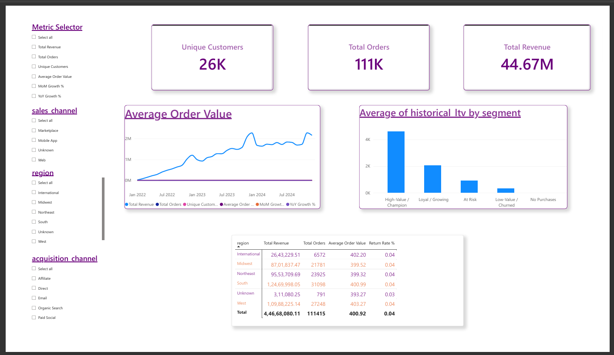

# E-Commerce Revenue & Customer LTV Analytics Engine

An end-to-end analytics pipeline that takes raw e-commerce transactional data through cleaning, SQL-based trend analysis, cohort/LTV modeling, and a Power BI executive dashboard — built to answer the questions leadership actually asks: *Is revenue growing? Who are our best customers? Which channels and regions are most profitable?*

**Stack:** Python (Pandas), SQL (SQLite, CTEs & window functions), Power BI (Advanced DAX, Field Parameters)

---

## Project Overview

| Stage | What it does | Tools |
|---|---|---|
| 1. Data Cleaning | Profiles and fixes 211K+ raw transactional records (nulls, duplicates, inconsistent formatting, bad quantities) | Python, Pandas |
| 2. SQL Analysis | Revenue trend aggregation and customer order frequency using CTEs and window functions | SQL (SQLite) |
| 3. Cohort & LTV Modeling | Monthly cohort retention curves, RFM segmentation, and predictive LTV by segment/channel | Python, Pandas |
| 4. BI Reporting | Interactive dashboard with dynamic slicers, field parameters, and DAX metric switching | Power BI |

**Dataset:** 26,000 customers, ~112,000 orders, 211,268 order line items, spanning Jan 2022 – Dec 2024. (Synthetically generated with realistic seasonality, channel-dependent churn, and customer value tiers — see [Methodology & Data Notes](#methodology--data-notes) for why and how.)

---

## Key Findings

- **Revenue grew from ~$20.7K/month (Jan 2022) to ~$2.16M/month (Dec 2024)** — roughly 100x — with consistent Nov/Dec seasonal spikes visible in every year of data.
- **Customer retention drops sharply after month 1** (~29% of a cohort returns in month 1) and then stabilizes around **20-25% retention through month 6+**, suggesting the biggest lever for LTV is improving early-lifecycle engagement, not just acquisition volume.
- **RFM segmentation** splits the customer base into four groups — High-Value/Champion (19%), Loyal/Growing (25%), At Risk (29%), Low-Value/Churned (27%) — with Champions carrying a predicted LTV of **~$5,200-5,500**, roughly **4x** the next tier down.
- **Affiliate and Email acquisition channels produce the highest-LTV Champions** ($5,487 and $5,468 respectively), despite not being the largest channels by volume — a signal that channel evaluation by acquisition cost alone would miss.

---

## Repository Structure

ecommerce-ltv-analytics/
├── data/
│ ├── raw/ # Generated raw data (intentionally messy)
│ └── processed/ # Cleaned data, SQLite DB, analysis outputs
├── docs/
│ └── images/ # Charts and dashboard screenshots
├── notebooks/ # (optional) exploratory notebook versions
├── powerbi/ # Star-schema CSVs + ecommerce_ltv_dashboard.pbix
├── scripts/
│ ├── generate_data.py # Phase 0: synthetic data generation
│ ├── clean_data.py # Phase 1: cleaning + SQLite load
│ ├── run_sql.py # Phase 2: SQL runner utility
│ ├── cohort_ltv_analysis.py # Phase 3: cohort, LTV, RFM
│ ├── visualize.py # Phase 3: chart generation
│ └── export_powerbi_star_schema.py # Phase 4: Power BI data export
└── sql/
├── 01_revenue_trends.sql # CTEs + window functions
└── 02_customer_order_frequency.sql

---

## Methodology

### 1. Data Cleaning (Python / Pandas)

Raw data included realistic data-quality issues: ~560 duplicate order rows, ~1,100 missing `sales_channel` values, ~200 missing `region` values, inconsistent category casing (`ELECTRONICS` vs `Electronics`), and ~420 negative-quantity entry errors. `scripts/clean_data.py` profiles the data before and after cleaning, resolves each issue, verifies referential integrity across tables, and loads the result into a SQLite database (`data/processed/ecommerce.db`) with indexes for query performance.

### 2. SQL Analysis (CTEs & Window Functions)

**`sql/01_revenue_trends.sql`** — aggregates net revenue by month via a CTE, then layers window functions on top: `SUM() OVER` for a running cumulative total, `LAG()` for month-over-month comparison, and a 3-month moving average using `ROWS BETWEEN 2 PRECEDING AND CURRENT ROW`.

**`sql/02_customer_order_frequency.sql`** — uses `ROW_NUMBER()` to sequence each customer's orders, `LAG()` to compute days between orders, `RANK()` to rank customers by order frequency, and `NTILE(4)` to bucket customers into lifetime-revenue quartiles.

### 3. Cohort Analysis & LTV Modeling (Python)

- **Cohort retention** is calculated using standard cohort methodology: customers are grouped by their *first purchase month* (not a separate acquisition-date field, which can diverge from actual first-order timing), then tracked month-by-month to build a retention matrix.
- **Historical LTV** is the sum of a customer's net (non-returned) revenue to date.
- **Predictive LTV** uses the standard formula: `LTV = Average Order Value × Purchase Frequency (orders/month) × Average Customer Lifespan (months)`, computed per segment × acquisition-channel combination.
- **RFM segmentation** scores every customer on Recency, Frequency, and Monetary value (quintile-based, 1-5 each), sums the three scores, and buckets customers into four segments used throughout the rest of the analysis.

### 4. Power BI Report

Data is exported into a proper **star schema** (`fact_order_items` + `dim_customers`, `dim_products`, `dim_date`) rather than flat tables, for clean relationships and correct DAX time-intelligence behavior. The report includes:

- **Field Parameters** driving a single chart that dynamically switches between six metrics (Total Revenue, Total Orders, Unique Customers, AOV, MoM Growth %, YoY Growth %) based on slicer selection — implemented via `CALCULATE`/`DATEADD`/`SAMEPERIODLASTYEAR` DAX time-intelligence measures underneath.
- **Dynamic slicers** for sales channel, region, and acquisition channel, enabling leadership to filter the entire report by any combination.
- **Regional profitability table** and **LTV-by-segment chart** answering the report's core business questions directly.

---

## Visuals

### Monthly Cohort Retention Heatmap
Each row is a cohort of customers acquired in that month; each column shows what % of that cohort was still purchasing N months later.

### Predicted LTV by Segment & Acquisition Channel

### Customer Segment Distribution (RFM)

### Monthly Revenue Trend

### Power BI Dashboard

*(Full interactive file: [`powerbi/ecommerce_ltv_dashboard.pbix`](powerbi/ecommerce_ltv_dashboard.pbix) — open in Power BI Desktop.)*

---

## How to Reproduce

\`\`\`bash
# 1. Set up environment
python -m venv venv
source venv/bin/activate   # or venv\\Scripts\\activate on Windows
pip install pandas numpy matplotlib seaborn jupyter

# 2. Generate the raw dataset
python scripts/generate_data.py

# 3. Clean the data and build the SQLite database
python scripts/clean_data.py

# 4. Run the SQL analysis
python scripts/run_sql.py sql/01_revenue_trends.sql
python scripts/run_sql.py sql/02_customer_order_frequency.sql

# 5. Run cohort/LTV/RFM analysis
python scripts/cohort_ltv_analysis.py

# 6. Generate charts
python scripts/visualize.py

# 7. Export the Power BI star schema
python scripts/export_powerbi_star_schema.py

# 8. Open powerbi/ecommerce_ltv_dashboard.pbix in Power BI Desktop
\`\`\`

---

## Methodology & Data Notes

This project uses a **synthetically generated dataset** rather than a public dataset, by deliberate choice: public e-commerce datasets rarely include the sales-channel, regional, and acquisition-channel fields needed to fully demonstrate cohort/LTV/regional-profitability analysis, and often lack the multi-year history needed for meaningful retention curves.

The generator (`scripts/generate_data.py`) builds in realistic underlying structure rather than pure randomness:
- Customer acquisition spread over a 3-year window with organic growth
- **Channel-dependent churn rates** (e.g., Direct/Organic customers churn slower than Paid Social)
- **Hidden customer value tiers** driving purchase frequency and order value, which the RFM/LTV analysis independently rediscovers — the same way a real analyst would uncover value segments without being told them in advance
- Seasonal order spikes in November/December
- Deliberately injected data-quality issues (nulls, duplicates, formatting inconsistencies, bad entries) so the cleaning step in Phase 1 has real problems to solve

This approach keeps the analytical methodology — the SQL, the cohort math, the LTV formula, the DAX — identical to what would be used on real transactional data, while giving full control over dataset size, time range, and business realism.

---

Built as an end-to-end portfolio project demonstrating the full analytics engineering lifecycle: extraction, cleaning, SQL analysis, statistical/behavioral modeling, and BI reporting.